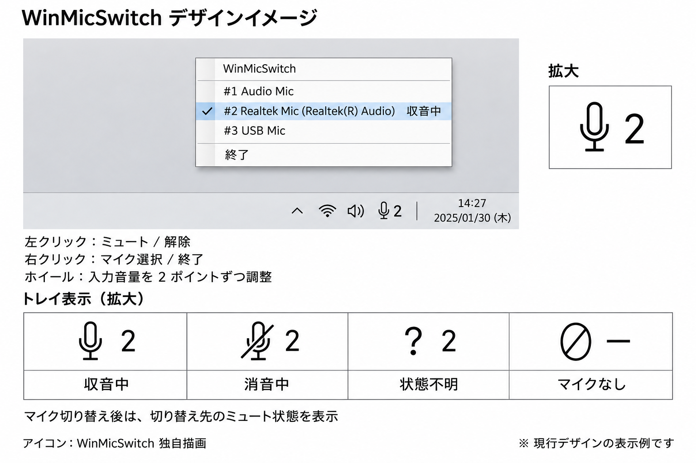
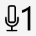

# WinMicSwitch

WinMicSwitch は、Windows 10／11 のタスクトレイから既定マイクのミュート・解除、入力音量の調整、マイクの切り替えができる個人用アプリです。通常ユーザー権限での利用を想定しています。

## 使い方

1. **起動する**　配布フォルダー内の `WinMicSwitch.exe` をダブルクリックします。DLL などの同梱ファイルは同じフォルダーに置いてください。起動すると、Windows の現在のマイク設定を読み取り、タスクバーの通知領域にアイコンが現れます。見当たらない場合は、時計の近くの「隠れているインジケーターを表示します」（∧）を開いてください。
2. **マイクをミュート・解除する**　アイコンを左クリックすると、現在の一般用マイクをミュートします。すでにミュート中なら解除します。アイコンにポインターを合わせると、対象のマイクと状態を確認できます。
3. **使うマイクを切り替える**　アイコンを右クリックし、一覧から使いたいマイク名を選びます。コンソール用・一般用・通信用の 3 つの既定入力を選んだマイクに切り替えます。一部だけ切り替わった場合は、用途ごとの結果をダイアログで確認できます。切り替え先がミュート中だった場合は、そのままミュート中です。入力を使うには、切り替え後にアイコンを左クリックして解除してください。
4. **入力音量を調整する**　アイコンにポインターを合わせてホイールを上に回すと、一般用マイクの入力音量が1ノッチあたり2ポイント上がります。下に回すと下がります。範囲は 0～100% です。ミュート中も設定音量を調整できます。メニューを閉じた状態で操作してください。
5. **終了する**　アイコンを右クリックし、「終了」を選びます。終了時点の既定入力とミュート状態は保持されます。

起動中にもう一度 exe を開くと、先に起動したアプリをそのまま使えます。メニューとツールチップは Windows の表示言語が日本語なら日本語、それ以外は英語で表示します。

### トレイ表示の見方

| アイコン | 意味 |
| --- | --- |
| マイク＋番号 | 一般用の既定マイクはミュート解除中です。番号に対応する機器名は右クリックで確認できます。 |
| 斜線付きマイク＋番号 | 一般用の既定マイクはミュート中です。 |
| 疑問符 | 状態を確認できません。右クリックすると最新の状態を再取得します。「自動更新停止」と表示されている間、「最終取得」は最後に読み取れた値です。 |
| 禁止記号＋「—」 | 使用できるマイクがありません。マイクを接続すると一覧が更新されます。 |

ツールチップは「WinMicSwitch: 83% 消音中 マイク (Realtek(R) Audio)」のように、入力音量、ミュート状態、機器名の順に表示します。Windows 側で音量を変更した場合も表示に反映されます。「収音中」は Windows のミュートが解除されている状態、メニューの「消音中」はツールチップの「ミュート」に対応します。音量を取得できないときはパーセントを省きます。右クリックメニューでは一般用の既定マイクにチェックが付きます。用途ごとの既定入力が異なる場合はメニューに内訳が表示され、左クリックとホイールは一般用だけに作用します。

## 開発状況

初版を C#、WinForms、Windows Core Audio で実装しました。Windows x64 ビルド 26300 で、Realtek マイクと Logi USB Headset H340 の往復切り替え、ミュートの保持、外部変更への追従、USB の抜き差し、起動・終了を確認しました。USB の抜き差しを実機で確認したのは採番方式の変更前です。現在の再採番は回帰テストで確認しています。一般用と通信用の入力が異なる場合、左クリックで一般用だけがミュート・解除されることも確認しました。実マイクの音量変更とツールチップへの反映は確認済みです。アイコン上での実ホイール操作、通話アプリ内での動作、Windows 10 での動作は未確認です。環境と結果は[詳細設計書の検証記録](docs/detailed-design.md#検証記録)を参照してください。

## ソースからのビルドとテスト

Windows x64、.NET SDK 10.0.404 で検証しました。リポジトリのルートで PowerShell から実行します。

```powershell
dotnet build WinMicSwitch.slnx -c Release -m:1 -p:UseSharedCompilation=false
.\tests\WinMicSwitch.Tests\bin\Release\net10.0-windows\WinMicSwitch.Tests.exe
.\src\WinMicSwitch\bin\Release\net10.0-windows\WinMicSwitch.exe
```

テストは Windows の対話セッションで実行します。標準実行はテスト用の入力操作と実機の読み取り・通知登録を確認します。`--live-tray` を付けると実マイクの入力音量とミュートを一時変更し、外部変更の表示追従と、同じマイクを選び直した後の3ロールを確認します。この実機テストは3ロールが同じ入力を使っている環境を前提とし、終了時に入力音量とミュートを開始時の値へ戻します。

2 台のマイクを使う `--two-mics` と、USB を手で抜き差しする `--hotplug` の引数・手順は[詳細設計書](docs/detailed-design.md#テストの構成)に記載しています。

配布用の自己完結版は次の手順で作成・起動します。

```powershell
dotnet publish src/WinMicSwitch/WinMicSwitch.csproj -c Release -r win-x64 --self-contained true -p:UseSharedCompilation=false -p:PublishTrimmed=false -p:PublishSingleFile=false -o artifacts/publish/win-x64 --source https://api.nuget.org/v3/index.json
.\artifacts\publish\win-x64\WinMicSwitch.exe
```

## 設計資料

- [基本設計書](docs/basic-design.md)
- [詳細設計書](docs/detailed-design.md)

## トレイの操作と表示例

### 現行デザインのコンセプト画像



### 実際の表示

Realtek マイクを一般用の既定入力にしたときの、アプリのアイコンです。



## 操作の補足

バックグラウンドで状態を更新している間に行った最初の操作は、更新後に操作に必要な対象と値を読み直して処理します。入力を確認できない場合は設定を変更せず、更新が終わってから失敗を知らせます。ミュート・音量調整・マイク選択の操作を受け付けてから結果確認が終わるまでの追加操作は破棄し、後からミュートを再反転させません。

完了直後でも、入力の記録時刻が完了時刻と同じミリ秒の場合は、前後を区別できないため破棄します。

インデックス番号は表示用とし、操作対象の識別にはエンドポイント ID を使います。使用可能なマイクを名前順（同名なら ID 順）に並べ、1 から番号を付けます。たとえば #1 を外して #2 だけが残ると、残ったマイクは #1 になります。

ミュート中、解除中、状態不明、利用可能なマイクがない場合を区別し、Windows 設定などでの既定マイクの変更、USB 機器の抜き差し、Windows が検知したミュート変更に追従します。

状態更新に必要な通知の登録に失敗した場合は、トレイを「状態不明」（入力が 0 件と確認できた場合は「マイクなし」）にし、ツールチップに「自動更新停止」と表示します。読み取れたミュート値は「最終取得」と明記します。左右クリックなどの再取得時に通知登録を再試行し、回復後に読み直した状態で通常表示へ戻します。

録音、ネットワーク通信、自動起動、グローバルキーフックは初版の対象外です。

## ライセンス

[MIT License](LICENSE)
